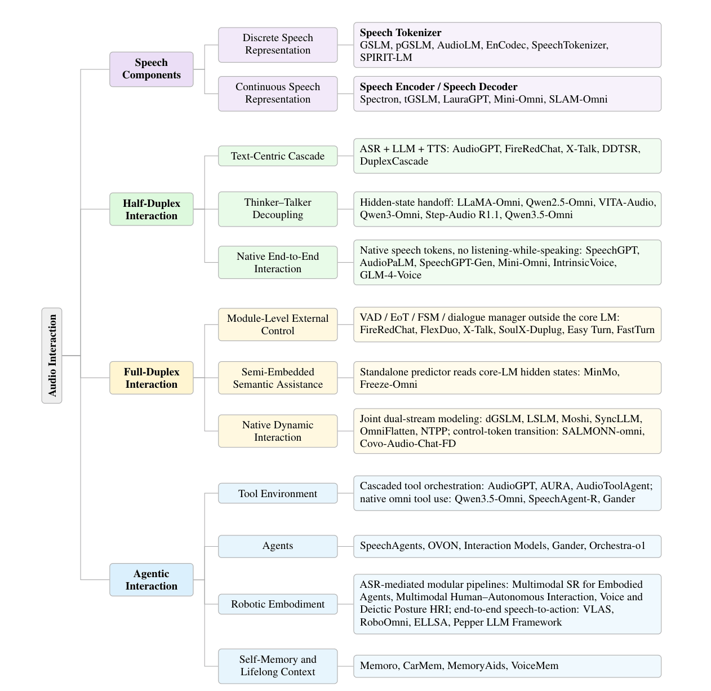

# Awesome Audio Interaction

<div align="center">

**[:house_with_garden: Project Page](https://github.com/HITsz-TMG/Awesome-Audio-Interaction)** | **[:memo: Paper](#)** | **[:black_nib: Citation](#citation)**

</div>

<div align="center">
This repository accompanies our survey of <b>Audio Interaction</b>.
</div>

<div align="center">
If you find this project useful, please consider giving us a star ⭐. We welcome recommendations for uncovered work via issues or pull requests.
</div>

<!--

## News

🔥 **[2026/10]**  The paper will be released on arXiv soon.

-->

## Contents

<table>
<tr><td>

- [1 Overview](#1-overview)
- [2 Roadmap of Audio Interaction](#2-roadmap-of-audio-interaction)
  - [2.1 Speech Components](#21-speech-components)
    - [2.1.1 Discrete Speech Representation](#211-discrete-speech-representation)
    - [2.1.2 Continuous Speech Representation](#212-continuous-speech-representation)
  - [2.2 Half-Duplex Speech Interaction](#22-half-duplex-speech-interaction)
    - [2.2.1 Text-Centric Cascaded Interaction](#221-text-centric-cascaded-interaction)
    - [2.2.2 Thinker–Talker Decoupled Interaction](#222-thinkertalker-decoupled-interaction)
    - [2.2.3 Native End-to-End Speech Interaction](#223-native-end-to-end-speech-interaction)
  - [2.3 Full-Duplex Speech Interaction](#23-full-duplex-speech-interaction)
    - [2.3.1 Module-Level External Control](#231-module-level-external-control)
    - [2.3.2 Semi-Embedded Semantic Assistance](#232-semi-embedded-semantic-assistance)
    - [2.3.3 Native Dynamic Interaction](#233-native-dynamic-interaction)
  - [2.4 Agentic Interaction](#24-agentic-interaction)
    - [2.4.1 Interaction with Tool Environment](#241-interaction-with-tool-environment)
    - [2.4.2 Interaction with Agents](#242-interaction-with-agents)
    - [2.4.3 Interaction with Robotic Embodiment](#243-interaction-with-robotic-embodiment)
    - [2.4.4 Interaction with Self-Memory and Lifelong Context](#244-interaction-with-self-memory-and-lifelong-context)
- [3 Dataset and Benchmark](#3-dataset-and-benchmark)
  - [3.1 Half-Duplex Speech Interaction](#31-half-duplex-speech-interaction)
  - [3.2 Full-Duplex Speech Interaction](#32-full-duplex-speech-interaction)
  - [3.3 Agentic Audio Interaction](#33-agentic-audio-interaction)
- [4 Related Surveys](#4-related-surveys)
- [Citation](#citation)
- [Star History](#star-history)

</td></tr>
</table>

## 1 Overview

Speech is the only modality that is natively full-duplex: what a speaker hears while speaking changes what is said next. A spoken interaction system must therefore decide continuously not only *what* to emit, but *whether* to emit at all, right now. The survey reads the field through **endogenization**: four contracts that govern every spoken exchange were first discharged by machinery outside the model and have been migrating into the model's own generative process.

| **Contract** | **Question it answers** | **Historically discharged by** |
|---|---|---|
| Representation | How does acoustic signal enter and leave the model? | Frozen encoders / vocoders |
| Language | Which language is the interaction internally conducted in? | Text bottleneck (ASR → LLM → TTS) |
| Timing | Who holds the floor at each instant? | VAD, endpointing, dialogue managers |
| Action | What may the model act upon beyond the utterance? | Developer-authored workflows |

Architecture describes how a system is built; endogenization describes **who decides**. A cascaded stack can behave full-duplex under an external dialogue manager, and an end-to-end model can remain turn-based.

<div align="center">
  
  <p><em>Taxonomy of audio interaction models: speech components, half-duplex, full-duplex, and agentic interaction. A system may appear in more than one branch.</em></p>
</div>

## 2 Roadmap of Audio Interaction

### 2.1 Speech Components

> Speech representations determine how acoustic signals enter and leave the model's representation space. The survey distinguishes discrete speech representations (speech tokenizers) from continuous speech representations (speech encoders and decoders). Representation type is orthogonal to the interaction paradigm: a discrete representation does not imply full-duplex interaction, and vice versa.

#### 2.1.1 Discrete Speech Representation

**Speech Tokenizer**

| **Name** | **Year** | **Venue** | **Token Type** | **Highlight** |
|---|---|---|---|---|
| [GSLM](https://aclanthology.org/2021.tacl-1.79/) | 2021 | TACL | SSL k-means units | Clusters self-supervised speech features into discrete units, models them autoregressively, and resynthesizes speech with a unit vocoder. |
| [pGSLM](https://arxiv.org/abs/2109.03264) | 2022 | ACL | Units + F0 + duration | Adds separate F0 and unit-duration streams to HuBERT content units to recover prosody. |
| [AudioLM](https://arxiv.org/abs/2209.03143) | 2023 | TASLP | Semantic + acoustic | Hierarchically models w2v-BERT semantic tokens and SoundStream acoustic tokens. |
| [EnCodec](https://arxiv.org/abs/2210.13438) | 2023 | TMLR | RVQ acoustic codec | Encoder–RVQ–decoder codec that compresses waveforms into multi-codebook acoustic tokens. |
| [SpeechTokenizer](https://arxiv.org/abs/2308.16692) | 2024 | ICLR | Semantic-distilled RVQ | Distills HuBERT semantics into the first RVQ layer while residual layers encode acoustic detail. |
| [SPIRIT-LM](https://arxiv.org/abs/2402.05755) | 2025 | TACL | Units (+ pitch/style) | Interleaves HuBERT units with text; the Expressive variant adds pitch and style tokens. |

#### 2.1.2 Continuous Speech Representation

**Speech Encoder / Speech Decoder**

| **Name** | **Year** | **Venue** | **Component** | **Representation** | **Highlight** |
|---|---|---|---|---|---|
| [LauraGPT](https://arxiv.org/abs/2310.04673) | 2023 | arXiv | Encoder | Audio-encoder latent | Continuous audio-encoder latents on the input side; discrete codec tokens on the output side. |
| [tGSLM](https://aclanthology.org/2023.emnlp-main.182/) | 2023 | EMNLP | Encoder | Word-sized embeddings | Encodes variable-length speech segments into continuous, roughly word-sized audio embeddings. |
| [CosyVoice 2](https://arxiv.org/abs/2412.10117) | 2024 | arXiv | Decoder | Flow-matching mel | Chunk-aware flow matching enables incremental waveform synthesis; adopted by MinMo and LLaMA-Omni 2. |
| [Mini-Omni](https://arxiv.org/abs/2408.16725) | 2024 | arXiv | Encoder | Whisper features | Frozen Whisper features enter the LLM through an adapter; output uses SNAC tokens (hybrid design). |
| [Spectron](https://arxiv.org/abs/2305.15255) | 2024 | ICLR | Encoder + decoder | Spectrogram | Uses unquantized spectrograms as both model input and prediction target. |
| [SLAM-Omni](https://aclanthology.org/2025.findings-acl.115/) | 2025 | ACL Findings | Encoder | Whisper features | Aligns Whisper encoder features to the LLM space through a linear projector. |

### 2.2 Half-Duplex Speech Interaction

> Half-duplex systems organize perception and generation into alternating turns. Core model modalities define three categories: text-to-text in cascaded systems, speech-to-text in Thinker–Talker systems, and speech-to-speech representation modeling in native end-to-end systems. Incremental processing and streaming generation can operate within alternating turns without making a system full-duplex.

#### 2.2.1 Text-Centric Cascaded Interaction

**Modular Systems and Language-Side Consolidation**

| **Name** | **Year** | **Venue** | **Type** | **Interface** | **Language Core** | **Execution** | **Highlight** |
|---|---|---|---|---|---|---|---|
| [GALAXY-II](https://doi.org/10.21437/ICSLP.1998-478) | 1998 | ICSLP | Architecture | Symbolic messages | Modular | Hub-controlled | Programmable hub that coordinates distributed speech and language servers. |
| [RavenClaw](https://doi.org/10.1016/j.csl.2008.10.001) | 2009 | CSL | Framework | Symbolic representations | Modular | Task-driven | Separates domain-specific task logic from domain-independent conversational skills. |
| [POMDP SDS](https://doi.org/10.1109/JPROC.2012.2225812) | 2013 | Proc. IEEE | Method | ASR/NLU hypotheses | Modular | Belief-driven | Belief-state reasoning for uncertainty-aware decisions under ASR/NLU errors. |
| [Wen et al.](https://aclanthology.org/E17-1042/) | 2017 | EACL | Model | Text | Neural TOD | – | Text-in/text-out end-to-end neural task-oriented dialogue. |
| [Sequicity](https://aclanthology.org/P18-1133/) | 2018 | ACL | Model | Text | Seq2seq | – | Single seq2seq model with an explicit belief span. |
| [SimpleTOD](https://arxiv.org/abs/2005.00796) | 2020 | NeurIPS | Model | Text | Causal LM | Autoregressive | Serializes belief state, dialogue act, and response for one causal LM. |
| [SOLOIST](https://aclanthology.org/2021.tacl-1.49/) | 2021 | TACL | Model | Text | Pretrained LM | Autoregressive | Pretrained autoregressive LM subsumes classical modules; transfer learning + machine teaching. |

**Modern Cascades and Capability Integration**

| **Name** | **Year** | **Venue** | **Type** | **Interface** | **Language Core** | **Execution** | **Highlight** |
|---|---|---|---|---|---|---|---|
| [AudioGPT](https://arxiv.org/abs/2304.12995) | 2024 | AAAI | Agent | Text / tool calls | ChatGPT | Tool-orchestrated | ChatGPT orchestrates ASR/TTS interfaces and external audio foundation models. |
| [ESPnet-SDS](https://aclanthology.org/2025.naacl-demo.21/) | 2025 | NAACL Demo | Toolkit | Configurable | Configurable | Configurable | Unified toolkit and evaluation framework comparing cascaded and end-to-end SDS. |
| [Eva](https://doi.org/10.5555/3709347.3744083) | 2025 | AAMAS | Agent | Text / tool calls | LLM | Agent-orchestrated | ASR–LLM–TTS cascade augmented with telephony, retrieval, and task agents. |
| [FireRedChat](https://arxiv.org/abs/2509.06502) | 2025 | arXiv | System | Text | LLM | External controller | FireRedASR → LLM → FireRedTTS; also has a semi-cascaded variant (see §2.3.1). |
| [LiveKit Agents](https://docs.livekit.io/agents/) | 2026 | Docs | Framework | Pipeline-dependent | Swappable | Configurable streaming | Pipeline selection and provider interchangeability (STT–LLM–TTS, realtime, half-cascade). |
| [Pipecat](https://docs.pipecat.ai/) | 2026 | Docs | Framework | Frames | Swappable | Frame-streaming | Frame-based streaming processor pipeline shared by STT, LLM, and TTS. |

**Incremental Processing and Latency Optimization**

| **Name** | **Year** | **Venue** | **Type** | **Interface** | **Language Core** | **Execution** | **Highlight** |
|---|---|---|---|---|---|---|---|
| [Schlangen & Skantze](https://aclanthology.org/2011.dnd-2.11/) | 2011 | Dialogue & Discourse | Method | Incremental units | Agnostic | Incremental | Formalizes incremental exchange of revisable partial hypotheses between modules. |
| [InproTK](https://aclanthology.org/W12-1814/) | 2012 | NAACL-HLT Workshop | Toolkit | Incremental units | Modular | Incremental | Toolkit operationalizing reusable incremental modules. |
| [Skantze & Hjalmarsson](https://doi.org/10.1016/j.csl.2012.05.004) | 2013 | CSL | Method | Incremental representations | Modular | Incremental | Coordinates interpretation, planning, realization, and self-monitoring as input unfolds. |
| [Telecom Agent](https://arxiv.org/abs/2508.04721) | 2025 | arXiv | Agent | Text | 4-bit LLM | Concurrent | Domain ASR/TTS, 4-bit quantized LLM, and RAG with concurrent execution. |
| [DDTSR](https://arxiv.org/abs/2602.23266) | 2026 | arXiv | Method | Streaming text | LLM | Cross-stage overlap | *Speak while thinking*: low-commitment discourse connectives + overlapped ASR/LLM/TTS (19–51% latency reduction). |
| [LTS-VoiceAgent](https://arxiv.org/abs/2601.19952) | 2026 | arXiv | Agent | Partial text | LLM | Semantically triggered | Dynamic Semantic Trigger decides *when to think* from partial input. |

**Boundary Cases beyond Turn-Level Half-Duplex**

| **Name** | **Year** | **Venue** | **Type** | **Interface** | **Language Core** | **Execution** | **Highlight** |
|---|---|---|---|---|---|---|---|
| [X-Talk](https://arxiv.org/abs/2512.18706) | 2025 | arXiv | System | Text events | LLM agent | Event-driven | Modular streaming orchestration with auxiliary acoustic analysis; extends cascades toward duplex behavior. |
| [DuplexCascade](https://arxiv.org/abs/2603.09180) | 2026 | arXiv | Method | Text micro-turns | LLM | VAD-free micro-turns | VAD-free ASR–LLM–TTS cascade where the LLM emits wait/respond/backchannel tokens over micro-turns. |

#### 2.2.2 Thinker–Talker Decoupled Interaction

| **Name** | **Year** | **Venue** | **Organization** | **Thinker (input / understanding)** | **Interface (Talker conditions)** | **Talker (generation / streaming)** |
|---|---|---|---|---|---|---|
| [Freeze-Omni](https://arxiv.org/abs/2411.00774) | 2025 | ICML | Tencent, NPU, NJU | Streaming encoder + adapter; frozen LLM | Text tokens + hidden-state prefix KV | NAR prefill + AR tokens; streaming codec |
| [LLaMA-Omni](https://arxiv.org/abs/2409.06666) | 2025 | ICLR | ICT/CAS, UCAS | Whisper + adapter; speech instructions | Response hidden states; no separate text input | NAR/CTC units; chunked vocoding |
| [LLaMA-Omni 2](https://arxiv.org/abs/2505.02625) | 2025 | arXiv | ICT/CAS, UCAS | Whisper + adapter; multi-turn adaptation | Text embeddings + response states; gated fusion | AR read/write scheduling; causal flow matching |
| [MinMo](https://arxiv.org/abs/2501.06282) | 2025 | arXiv | Alibaba | SenseVoice + projector; speech, emotion, events | Text embeddings + query/response states; projection | AR tokens; fixed interleaving; chunked flow matching |
| [Qwen2.5-Omni](https://arxiv.org/abs/2503.20215) | 2025 | arXiv | Alibaba | Audio/vision encoders; TMRoPE alignment | Text embeddings + Thinker states; shared history | Dual-track AR; sliding-window flow matching |
| [Qwen3-Omni](https://arxiv.org/abs/2509.17765) | 2025 | arXiv | Alibaba | AuT + vision encoder; temporal-ID alignment | Historical/streaming text + multimodal states | AR + residual-codebook MTP; causal ConvNet |
| [Step-Audio R1.1 (Mind-Paced Speaking)](https://arxiv.org/abs/2510.09592) | 2025 | arXiv | StepFun | Formulation Brain produces segmented reasoning | Reasoning pace and context | Articulation Brain streams speech |
| [Uni-MoE](https://arxiv.org/abs/2405.11273) | 2025 | TPAMI | HITsz | Audio/speech connectors; modality-specific experts | – (understanding-side example) | – |
| [Uni-MoE-2.0-Omni](https://arxiv.org/abs/2511.12609) | 2025 | arXiv | HITsz | Continuous audio features into language backbone | Response text + voice-control prompts | Context-aware MoE-TTS; conditions on previous speech segments |
| [Qwen3.5-Omni](https://arxiv.org/abs/2604.15804) | 2026 | arXiv | Alibaba | AuT + vision encoder; explicit timestamps | Historical/streaming text + multimodal states; voice prompt | ARIA interleaving; multi-codebook prediction; causal ConvNet |

#### 2.2.3 Native End-to-End Speech Interaction

**From Speech Language Modeling to Real-Time Speech-to-Speech Interaction**

| **Name** | **Year** | **Venue** | **Organization** | **Speech Representation** | **Highlight** |
|---|---|---|---|---|---|
| [AudioPaLM](https://arxiv.org/abs/2306.12925) | 2023 | arXiv | Google | Unified text/speech vocabulary | Single decoder-only model over a joint text–speech token vocabulary. |
| [SpeechGPT](https://arxiv.org/abs/2305.11000) | 2023 | EMNLP Findings | FDU | HuBERT discrete units | Extends a pretrained LLM with discrete speech units and cross-modal instruction tuning. |
| [GLM-4-Voice](https://arxiv.org/abs/2412.02612) | 2024 | arXiv | THU, Zhipu.AI | 12.5 Hz single codebook | ASR-derived VQ tokenizer (175 bps) with a streaming decoder controlling emotion, rate, and dialect. |
| [IntrinsicVoice](https://arxiv.org/abs/2410.08035) | 2024 | arXiv | FDU, Alibaba | Grouped HuBERT units | GroupFormer compresses speech to text-like length; sub-100 ms model-side latency. |
| [Mini-Omni](https://arxiv.org/abs/2408.16725) | 2024 | arXiv | Inspirai, THU | Whisper in / SNAC out | Text-instructed speech generation with parallel text–audio inference for low-latency turns. |
| [SpeechGPT-Gen](https://arxiv.org/abs/2401.13527) | 2024 | arXiv | FDU | SpeechTokenizer semantic tokens | LLM predicts semantic tokens; a flow-matching module adds perceptual detail. |
| [USDM](https://arxiv.org/abs/2402.05706) | 2024 | NeurIPS | SNU, NAVER | Speech tokens | Unified speech–text pretraining preserving prosody carried by speech tokens. |

**Core Architectural Design Space**

| **Name** | **Year** | **Venue** | **Organization** | **Speech Representation** | **Highlight** |
|---|---|---|---|---|---|
| [Flow-Omni](https://arxiv.org/abs/2412.04917) | 2024 | arXiv | THU, Microsoft | Continuous speech tokens | Autoregressive LLM + flow matching over continuous-valued speech tokens. |
| [Baichuan-Audio](https://arxiv.org/abs/2502.17239) | 2025 | arXiv | Baichuan | 12.5 Hz multi-codebook | Multi-codebook tokens keep semantic and acoustic cues; interleaved audio–text generation. |
| [Kimi-Audio](https://arxiv.org/abs/2504.18425) | 2025 | arXiv | Moonshot AI | Continuous in / discrete out | Hybrid representation with chunk-wise flow-matching detokenizer; >13M hours of pretraining audio. |
| [SLAM-Omni](https://aclanthology.org/2025.findings-acl.115/) | 2025 | ACL Findings | SJTU, SII, Microsoft | Semantic tokens (grouped) | Speaker identity moved to the vocoder; grouped semantic-token prediction and historical text prompting. |
| [VITA-Audio](https://arxiv.org/abs/2505.03739) | 2025 | arXiv | Tencent, NJU, XMU | Audio tokens | Multiple Cross-modal Token Prediction emits several audio tokens per forward pass (3–5× speedup at 7B). |

**Recent Progress: Audio-Native Intelligence**

| **Name** | **Year** | **Venue** | **Organization** | **Speech Representation** | **Highlight** |
|---|---|---|---|---|---|
| [Step-Audio 2](https://arxiv.org/abs/2507.16632) | 2025 | arXiv | StepFun | Latent encoder + audio tokens | Audio-native reasoning with reasoning-oriented RL; paralinguistics shape both content and rendering. |
| [MOSS-Speech](https://openreview.net/forum?id=zjaV5zmlkl) | 2026 | ICLR | SII, FDU, MOSI | Direct speech pathway | Modality-specific layer splitting and frozen pretraining reduce explicit text mediation. |

**Industrial Deployment**

| **Name** | **Year** | **Venue** | **Organization** | **Speech Representation** | **Highlight** |
|---|---|---|---|---|---|
| [EVI 3](https://www.hume.ai/blog/introducing-evi-3) | 2025 | Product | Hume AI | – | Jointly models linguistic content and vocal behavior for expressive control. |
| [Nova 2 Sonic](https://aws.amazon.com/blogs/aws/) | 2025 | Product | Amazon | – | Streaming speech understanding and multilingual generation for assistants and customer service. |
| [Gemini 3.8 Live](https://blog.google/innovation-and-ai/models-and-research/gemini-models/) | 2026 | Product | Google | – | Audio input, low-latency speech generation, multimodal context, and reasoning. |
| [GPT-Realtime-2.1](https://developers.openai.com/api/docs/models/gpt-realtime-2.1) | 2026 | Product | OpenAI | – | Native speech I/O with reasoning, instruction following, and tool integration. |
| [Qwen-Audio-3.1-Realtime-Plus](https://www.alibabacloud.com/help/en/model-studio/) | 2026 | Product | Alibaba | – | Push-to-talk turn-based mode with function calling and search. |

### 2.3 Full-Duplex Speech Interaction

> Full-duplex systems listen while speaking. The survey separates them by where the listen/speak decision is made: outside the core model (module-level external control), on the content model's hidden states (semi-embedded semantic assistance), or inside the generated sequence itself (native dynamic interaction).

#### 2.3.1 Module-Level External Control

**VAD / EoT / FSM / Dialogue Manager outside the Core LM**

| **Name** | **Year** | **Venue** | **Organization** | **Control Module** | **Highlight** |
|---|---|---|---|---|---|
| [Easy Turn](https://arxiv.org/abs/2509.23938) | 2025 | arXiv | – | Bimodal turn detector | Fuses acoustic and linguistic cues to classify complete / incomplete / backchannel / wait. |
| [FireRedChat](https://arxiv.org/abs/2509.06502) | 2025 | arXiv | Xiaohongshu | pVAD + semantic EoT + DM | External controller schedules a replaceable cascaded or semi-cascaded generator. |
| [FlexDuo](https://arxiv.org/abs/2502.13472) | 2025 | arXiv | – | Listen/Speak/Idle FSM | Pluggable three-state controller that filters irrelevant audio and drives any half-duplex model. |
| [X-Talk](https://arxiv.org/abs/2512.18706) | 2025 | arXiv | – | Event bus + VAD | Duplex behavior emerges from an event-driven bus coordinating modular components. |
| [FastTurn](https://arxiv.org/abs/2604.01897) | 2026 | arXiv | – | Streaming CTC + acoustic turn detector | Uses partial CTC transcripts and acoustic cues to anticipate end-of-turn, hesitation, and backchannel. |
| [SoulX-Duplug](https://arxiv.org/abs/2603.14877) | 2026 | arXiv | Soul AI | Streaming state predictor | Plug-and-play semantic VAD with joint ASR supervision for a frozen downstream LLM. |

#### 2.3.2 Semi-Embedded Semantic Assistance

**Auxiliary Timing Prediction on a Shared Content Backbone**

| **Name** | **Year** | **Venue** | **Shared Representation** | **Timing Prediction** | **Training** | **Response Control** |
|---|---|---|---|---|---|---|
| [Freeze-Omni](https://arxiv.org/abs/2411.00774) | 2025 | ICML | Final-layer LLM state at chunk boundaries | Three states: receive; interrupt; no interrupt | Frozen LLM; joint state and text losses | State-guided input handling and regeneration |
| [MinMo](https://arxiv.org/abs/2501.06282) | 2025 | arXiv | Content-LLM hidden states | Duplex predictor: respond or stop output | Predictor-only duplex alignment | Start reply or stop speech output |
| [SpokenUS](https://arxiv.org/abs/2603.16783) | 2026 | arXiv | LLM states with task goal, profile, and history | Listen; barge-in; turn-end | Joint text, speech, and turn objectives | Smoothed decisions trigger speech generation |
| [UAF](https://arxiv.org/abs/2604.19221) | 2026 | arXiv | Shared LLM states with speaker, audio, and text context | Separate VAD and turn heads | Multi-task objectives; LoRA tuning | Separate state tracking from text generation |

**Behavior Control and Response Selection on Native Backbones**

| **Name** | **Year** | **Venue** | **Shared Representation** | **Timing Prediction** | **Training** | **Response Control** |
|---|---|---|---|---|---|---|
| [Controlling Backchannels](https://arxiv.org/abs/2609.29418) | 2026 | arXiv | Hidden states of the base model (PersonaPlex, F-Actor) | Auxiliary assistant-BC onset head | Backchannel-onset supervision | Threshold-triggered BC generation |
| [RePlay](https://arxiv.org/abs/2609.31588) | 2026 | arXiv | Retained PersonaPlex hidden states | Turn-timing and retrieval heads | Turn-head and retrieval-head training | Select and play prerecorded replies |

**Related Speech-Decision Readout (not an online dialogue controller)**

| **Name** | **Year** | **Venue** | **Shared Representation** | **Timing Prediction** | **Training** | **Response Control** |
|---|---|---|---|---|---|---|
| [DuplexJev](https://arxiv.org/abs/2610.02638) | 2026 | arXiv | Audio- and query-conditioned LLM states | Answer-option token scores | Frozen LLM; option supervision and distillation | Read option scores without full decoding |

#### 2.3.3 Native Dynamic Interaction


**Multi-Stream Parallel Modeling**

| **Name** | **Year** | **Venue** | **Sequence Layout** | **Highlight** |
|---|---|---|---|---|
| [dGSLM](https://aclanthology.org/2023.tacl-1.15/) | 2023 | TACL | Dual-tower, two unit streams | Cross-attention dual-tower Transformer reproduces pauses and overlaps in offline dialogue continuation. |
| [Moshi](https://arxiv.org/abs/2410.00037) | 2024 | arXiv | Multi-stream, 80 ms frames | User audio, assistant audio, and text on a shared grid; Temporal + Depth Transformer and Inner Monologue. |
| [Fun-Audio-Chat-Duplex](https://arxiv.org/abs/2512.20156) | 2025 | arXiv | Dual-resolution (5 Hz / 25 Hz) | Shared 5 Hz backbone with a 25 Hz speech refinement head; 99.94% turn-taking success on UltraEval-Audio duplex test. |
| [LSLM](https://arxiv.org/abs/2408.02622) | 2025 | AAAI | Listening + speaking channels | Fuses a streaming SSL listening channel into token-based speaking for real-time turn and interruption detection. |
| [NTPP](https://arxiv.org/abs/2506.00975) | 2025 | ICML | Dual-channel token pairs | Jointly predicts token pairs of both channels to model overlap, backchannel, and pauses. |

**Flattened Sequences and Chunk-Based Alternation**

| **Name** | **Year** | **Venue** | **Sequence Layout** | **Highlight** |
|---|---|---|---|---|
| [SyncLLM](https://aclanthology.org/2024.emnlp-main.1192/) | 2024 | EMNLP | Fixed-duration chunk alternation | Estimates the not-yet-arrived user chunk to prepare the next reply, then replaces it with the observed input. |
| [OmniFlatten](https://aclanthology.org/2025.acl-long.709/) | 2025 | ACL | Flattened user-speech / text / speech chunks | Progressive modality → half-duplex → full-duplex training of a standard GPT; silence tokens fill gaps. |
| [MiniCPM-o 4.5](https://arxiv.org/abs/2604.27393) | 2026 | arXiv | Time-window interleaving (TAIL) | Time-Aligned Interleaving adjusts text per chunk to playback progress so text does not run ahead of speech. |

**Explicit State Tokens**

| **Name** | **Year** | **Venue** | **Sequence Layout** | **Highlight** |
|---|---|---|---|---|
| [SALMONN-omni](https://arxiv.org/abs/2505.17060) | 2025 | NeurIPS | Chunked continuous features + <shift>/<think> | State tokens trigger listen–speak transitions; DPO separates interruptions from acknowledgments. |
| [BayLing-Duplex](https://arxiv.org/abs/2606.14528) | 2026 | arXiv | Flattened sequence with fine-grained end states | Separates text-end from speech-end; silence-token down-weighting raises 3 s turn-taking success from 60.3% to 88.9%. |
| [Covo-Audio-Chat-FD](https://arxiv.org/abs/2602.09823) | 2026 | arXiv | THINK / SHIFT / BREAK tokens | Output stream continuously emits control tokens that start and stop speaking. |

**Interaction Training and Behavior Control**

| **Name** | **Year** | **Venue** | **Sequence Layout** | **Highlight** |
|---|---|---|---|---|
| [F-Actor](https://arxiv.org/abs/2601.11329) | 2026 | ACL Findings | Prompt-conditioned full-duplex | Instructions set who initiates and how many backchannels / assistant interruptions occur. |
| [Interactivity Alignment](https://arxiv.org/abs/2606.11167) | 2026 | arXiv | Moshi / PersonaPlex | Multi-objective RL on real pause/turn/backchannel/barge-in segments with a response-quality reward. |
| [PersonaPlex](https://arxiv.org/abs/2602.06053) | 2026 | ICASSP | Moshi-style multi-stream | Role descriptions and reference voices in the prompt control persona and voice. |

### 2.4 Agentic Interaction

> Agentic interaction extends spoken dialogue to tool environments, other agents, robotic embodiment, and lifelong memory. Voice keeps a continuous, interruptible entry point for the user, while task correctness depends on task representation, shared state, and execution protocol.

#### 2.4.1 Interaction with Tool Environment

**Cascaded Tool Orchestration**

| **Name** | **Year** | **Venue** | **Loop** | **Highlight** |
|---|---|---|---|---|
| [AudioGPT](https://arxiv.org/abs/2304.12995) | 2024 | AAAI | Speech/text → ChatGPT → audio models | ChatGPT plans and invokes audio foundation models through ASR/TTS interfaces. |
| [AudioToolAgent](https://arxiv.org/abs/2510.02995) | 2025 | arXiv | Central LLM → audio QA / ASR tools | Central LLM selects tools, issues follow-up queries, and arbitrates conflicting outputs. |
| [AURA](https://arxiv.org/abs/2506.23049) | 2025 | arXiv | Speech → ReAct → calendar/contacts/email/web APIs | Speech-to-speech task agent handling compound multi-turn goals with external tools. |

**Native Omni Tool Use**

| **Name** | **Year** | **Venue** | **Loop** | **Highlight** |
|---|---|---|---|---|
| [Gander](https://arxiv.org/abs/2609.08977) | 2026 | arXiv | Cerebellum ↔ Brain via tool calls | Real-time interaction layer and task layer connected by tool calling and an orchestration runtime. |
| [Qwen3.5-Omni](https://arxiv.org/abs/2604.15804) | 2026 | arXiv | Omni Thinker → WebSearch / FunctionCall | Native omni model with autonomous web search and complex function calling. |
| [SpeechAgent-R](https://arxiv.org/abs/2608.01881) | 2026 | arXiv | Raw audio → acoustic skills/tools → answer | Multi-turn RL learns to coordinate tools whose intermediate results feed later audio reasoning. |

#### 2.4.2 Interaction with Agents

**Frontend–Backend Layered Delegation**

| **Name** | **Year** | **Venue** | **Collaboration Pattern** | **Highlight** |
|---|---|---|---|---|
| [Gander](https://arxiv.org/abs/2609.08977) | 2026 | arXiv | Cerebellum / orchestrator / cerebrum | Explicit task lifecycle (create, continue, fork, cancel, return); FDB-v3 Pass@1 0.400 end-to-end vs. 0.520 backend-only. |
| [GPT-Live](https://openai.com/index/introducing-gpt-live/) | 2026 | Product | Full-duplex frontend → frontier model | Full-duplex voice frontend keeps the conversation while search and deep reasoning run behind an asynchronous boundary. |
| [Interaction Models](https://thinkingmachines.ai/blog/interaction-models) | 2026 | Blog | Real-time model → background model | Real-time audio/video/text model asynchronously delegates long reasoning and tool tasks to a background model sharing context. |

**Peer-to-Peer and Manager–Specialist Collaboration**

| **Name** | **Year** | **Venue** | **Collaboration Pattern** | **Highlight** |
|---|---|---|---|---|
| [OVON](https://arxiv.org/abs/2407.19438) | 2024 | arXiv | Universal NL API | Service discovery and a common API for voicebots, chatbots, and human agents. |
| [SpeechAgents](https://arxiv.org/abs/2401.03945) | 2024 | arXiv | Shared voice-message stream | Role-specific agents read and write a shared voice stream, using speech as a native inter-agent medium. |
| [Audio-Oscar](https://arxiv.org/abs/2606.07397) | 2026 | arXiv | Specialist pipeline | Role modeling, timeline planning, model selection, critique-and-repair, and mixing via structured intermediates. |
| [Orchestra-o1](https://arxiv.org/abs/2606.13707) | 2026 | arXiv | Orchestrator + specialized sub-agents | Decomposes omnimodal (incl. audio) tasks and executes specialized sub-agents in parallel. |
| [STEAMROLLER](https://arxiv.org/abs/2601.10223) | 2026 | AAAI | Repair agents + master agent | Parallel repair agents fix stuttered ASR transcripts; gains saturate after a few agents while latency grows. |

#### 2.4.3 Interaction with Robotic Embodiment

<div align="center">
  
  <p><em>Embodied speech interaction: physical and communicative feedback couple spoken intent, grounded execution, and observed task state.</em></p>
</div>

**Grounding Spoken Instructions**

| **Name** | **Year** | **Venue** | **Setting** | **Highlight** |
|---|---|---|---|---|
| [MM-ASR](https://arxiv.org/abs/2302.14030) | 2023 | Interspeech | ALFRED (sim) | Visual context improves recognition of corrupted spoken instructions and downstream task completion. |
| [ASR–LLM–VLM](https://arxiv.org/abs/2403.12273) | 2024 | arXiv | Real robot | Connects speech recognition with pretrained language and vision models to produce robot commands. |
| [NMM-HRI](https://arxiv.org/abs/2501.00785) | 2025 | IEEE RAM | Real manipulator | Fuses transcribed speech, pointing posture, and RGB-D observations to resolve object and location references. |
| [VLAS](https://arxiv.org/abs/2502.13508) | 2025 | ICLR | Manipulation | Action policy conditioned directly on speech and images; Voice RAG retrieves speaker-specific knowledge. |

**Corrections during Execution**

| **Name** | **Year** | **Venue** | **Setting** | **Highlight** |
|---|---|---|---|---|
| [Interactive Language](https://arxiv.org/abs/2210.06407) | 2022 | arXiv | Real tabletop robot | Successive spoken instructions condition a visuomotor policy in real time. |
| [YAY Robot](https://arxiv.org/abs/2403.12910) | 2024 | arXiv | Real robot | Verbal stops and corrections override the high-level policy and are later used to improve it. |
| [ILU–MPC](https://arxiv.org/abs/2508.06095) | 2025 | arXiv | Manipulator | Incremental understanding updates goals, constraints, and speed while the arm is moving. |

**Clarifying Intent before Action**

| **Name** | **Year** | **Venue** | **Setting** | **Highlight** |
|---|---|---|---|---|
| [RoboOmni](https://arxiv.org/abs/2510.23763) | 2026 | ICLR | Real robot | Infers implicit intent from conversation, environmental sound, and vision, then confirms verbally before acting. |

**Full-Duplex Embodied Interaction**

| **Name** | **Year** | **Venue** | **Setting** | **Highlight** |
|---|---|---|---|---|
| [VITA-E](https://arxiv.org/abs/2510.21817) | 2025 | arXiv | Humanoid robot | Active and standby models enable concurrent conversation, task switching, and emergency stop. |
| [ELLSA](https://arxiv.org/abs/2510.16756) | 2026 | ICLR | Simulated manipulation | Streaming multimodal model that speaks while acting and supports action barge-in. |
| [MIRA](https://arxiv.org/abs/2609.24547) | 2026 | arXiv | Embodied companion | Interruptible social behavior and co-speech motion; 466 ms median speech-onset-to-abort-dispatch latency. |
| [Pepper Framework](https://arxiv.org/abs/2603.21013) | 2026 | arXiv | Pepper robot | Mutes the microphone during speech (no echo cancellation) and uses touchscreen interruption instead. |

#### 2.4.4 Interaction with Self-Memory and Lifelong Context

**Retention and Maintenance**

| **Name** | **Year** | **Venue** | **Modality** | **Highlight** |
|---|---|---|---|---|
| [MemoryBank](https://doi.org/10.1609/aaai.v38i17.29946) | 2024 | AAAI | Text | Stores histories, event summaries, and profiles with time-based decay and recall reinforcement. |
| [CarMem](https://aclanthology.org/2025.coling-industry.29/) | 2025 | COLING Industry | Voice (in-car) | Extracts preferences into predefined categories and maintains redundant or contradictory entries. |

**Consolidation and Organization**

| **Name** | **Year** | **Venue** | **Modality** | **Highlight** |
|---|---|---|---|---|
| [A-MEM](https://arxiv.org/abs/2502.12110) | 2025 | NeurIPS | Text | Structured notes linked to earlier ones; new information can update existing notes. |
| [RMM](https://aclanthology.org/2025.acl-long.413/) | 2025 | ACL | Text | Multi-granularity summaries with retrieval refined by answer-attributed evidence. |

**Real-Time Retrieval and Proactive Use**

| **Name** | **Year** | **Venue** | **Modality** | **Highlight** |
|---|---|---|---|---|
| [Memoro](https://arxiv.org/abs/2403.02135) | 2024 | CHI | Voice (wearable) | Wearable audio memory assistant with Query and Queryless modes for minimally disruptive recall. |
| [EgoMem](https://arxiv.org/abs/2509.11914) | 2025 | arXiv | Audio-visual | User identification and retrieval run alongside dialogue with an asynchronous memory-management process. |
| [MemoryAids](https://doi.org/10.1109/ICASSP55912.2026.11462192) | 2026 | ICASSP | Voice (live) | Monitors live conversation to decide when to recall or record, presenting brief visual prompts. |
| [VoiceMem](https://arxiv.org/abs/2608.26005) | 2026 | arXiv | Voice (streaming) | Retrieves facts and persona from partial transcripts before the reply is due (134 ms retrieval latency). |

**Evaluation of Memory Use**

| **Name** | **Year** | **Venue** | **Modality** | **Highlight** |
|---|---|---|---|---|
| [ContextDialog](https://aclanthology.org/2025.findings-acl.470/) | 2025 | ACL Findings | Voice | Tests recall and use of earlier spoken turns; models struggle even with retrieval augmentation. |
| [LongMemEval](https://arxiv.org/abs/2410.10813) | 2025 | ICLR | Text | Extraction, multi-session and temporal reasoning, knowledge updates, and abstention over long histories. |

## 3 Dataset and Benchmark

### 3.1 Half-Duplex Speech Interaction

**Training Sets**

| **Name** | **Year** | **Venue** | **Task** | **Scale** | **Modality** | **Annotation** |
|---|---|---|---|---|---|---|
| [SpeechInstruct](https://arxiv.org/abs/2305.11000) | 2023 | EMNLP Findings | Instruction following | 37,969 QA | Speech, text | Instruction transcripts; reference responses |
| [VoiceAssistant-400K](https://arxiv.org/abs/2408.16725) | 2024 | arXiv | Assistant QA | 400K QA | Speech, text | Question transcripts; reference responses |
| [InstructS2S-200K](https://arxiv.org/abs/2409.06666) | 2025 | ICLR | Instruction following | 200K QA | Speech, text | Instruction transcripts; reference responses |
| [InstructS2S-200K (multi-turn)](https://arxiv.org/abs/2505.02625) | 2025 | arXiv | Multi-turn dialogue | 200K conversations | Speech, text | Turn transcripts; reference responses |

**Training and Evaluation Sets**

| **Name** | **Year** | **Venue** | **Task** | **Scale** | **Modality** | **Annotation** |
|---|---|---|---|---|---|---|
| [SpokenWOZ](https://arxiv.org/abs/2305.13040) | 2023 | NeurIPS | DST; response generation | 249 h | Speech, text | Transcripts; dialogue states; dialogue acts |
| [SD-Eval](https://arxiv.org/abs/2406.13340) | 2024 | NeurIPS | Context-aware responding | 1,061.48 h | Audio, text | Response text; emotion, accent, age, scene labels |
| [StyleTalk](https://aclanthology.org/2024.acl-long.358/) | 2024 | ACL | Style-aware responding | 2,967 QA | Speech, text | Response text; emotion, speed, volume labels |

**Evaluation Sets**

| **Name** | **Year** | **Venue** | **Task** | **Scale** | **Modality** | **Annotation** |
|---|---|---|---|---|---|---|
| [ADU-Bench](https://arxiv.org/abs/2412.05167) | 2024 | arXiv | Ambiguity resolution | 1,390 QA | Speech, text | Reference responses |
| [VoiceBench](https://arxiv.org/abs/2410.17196) | 2024 | arXiv | QA; instructions; safety | 5,783 QA | Speech, text | Answers; constraints |
| [OpenAudioBench](https://arxiv.org/abs/2502.17239) | 2025 | arXiv | Spoken QA; reasoning | 2,701 QA | Speech, text | Reference answers |
| [TELEVAL](https://arxiv.org/abs/2507.18061) | 2025 | arXiv | Spoken QA; conversation | 44,772 QA | Audio, text | Answers; emotion and age labels |
| [URO-Bench](https://arxiv.org/abs/2502.17810) | 2025 | arXiv | Multi-turn dialogue | 510 QA | Speech, text | Reference responses |
| [VocalBench](https://arxiv.org/abs/2505.15727) | 2025 | arXiv | Multi-turn dialogue | 400 QA | Speech, text | Reference responses |
| [VoiceAssistant-Eval](https://arxiv.org/abs/2509.22651) | 2025 | arXiv | Dialogue; roleplay; instructions; safety | 6,905 QA | Speech, text | Reference responses |

### 3.2 Full-Duplex Speech Interaction

| **Name** | **Year** | **Venue** | **Behavior** | **Scenario** |
|---|---|---|---|---|
| [UltraEval-Audio (duplex)](https://github.com/OpenBMB/UltraEval-Audio) | 2025 | GitHub | Turn-taking success; spoken QA | Duplex test suite |
| [Full-Duplex-Bench-v2](https://arxiv.org/abs/2510.07838) | 2026 | ACL | Turn-taking; correction; entity tracking; safety | Multi-turn, automated examiner |

### 3.3 Agentic Audio Interaction

| **Name** | **Year** | **Venue** | **Behavior** | **Scenario** |
|---|---|---|---|---|
| [ContextDialog](https://aclanthology.org/2025.findings-acl.470/) | 2025 | ACL Findings | Spoken context recall | Multi-turn voice interaction |
| [LongMemEval](https://arxiv.org/abs/2410.10813) | 2025 | ICLR | Long-term memory | Multi-session text histories |
| [Full-Duplex-Bench-v3](https://arxiv.org/abs/2604.04847) | 2026 | arXiv | Multi-step tool use; turn-taking; disfluency | Real human audio, 4 API domains |

## 4 Related Surveys

| **Name** | **Year** | **Venue** |
|---|---|---|
| [Spoken Dialogue Technology](https://doi.org/10.1145/505282.505285) | 2002 | ACM Computing Surveys |
| [LLM Survey](https://arxiv.org/abs/2303.18223) | 2023 | arXiv |
| [WavChat](https://arxiv.org/abs/2411.13577) | 2024 | arXiv |
| [LALM Evaluation Survey](https://arxiv.org/abs/2505.15957) | 2025 | arXiv |
| [SpeechLM Survey](https://aclanthology.org/2025.acl-long.682/) | 2025 | ACL |


Please keep each entry under the subsection that matches the survey, and describe the work in one factual sentence (no promotional wording).

 <!--
## Citation

If you find this work useful for your research, please cite our survey:

```bibtex
@article{audiointeraction2026survey,
  title   = {Audio Interaction Survey},  % TODO: final title
  author  = {TODO},
  journal = {arXiv preprint arXiv:XXXX.XXXXX},
  year    = {2026}
}
```

 --> 
 
## Star History

[](https://www.star-history.com/#HITsz-TMG/Awesome-Audio-Interaction&Date)
